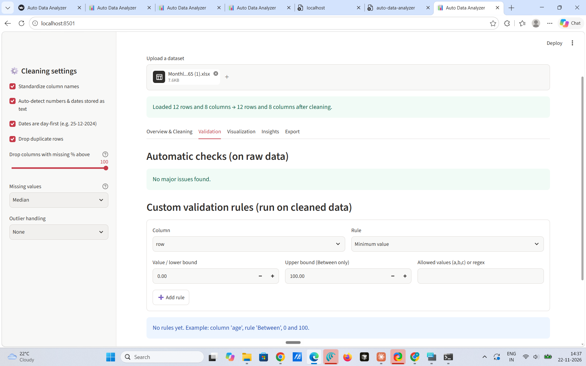
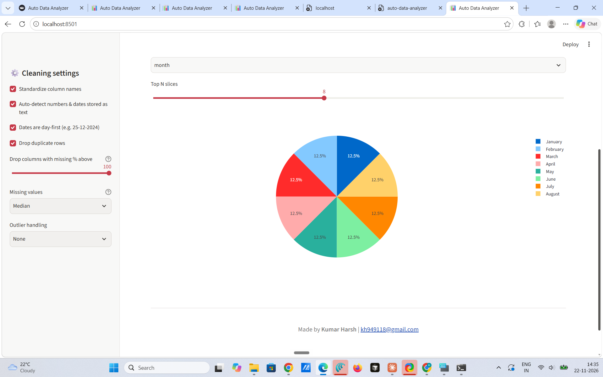

# 📊 Auto Data Analyzer

Upload a CSV or Excel file and get automatic cleaning, validation, charts, insights and exports.

## Features
- **Upload once**: CSV, XLSX and XLS files, with a sheet picker for multi-sheet Excel files
- **Smart cleaning**: fixes column names, trims whitespace, converts numbers and dates stored as text (e.g. "PKR 1,200", "25-12-2024")
- **Sidebar settings**: missing-value method (median, mean, drop rows, leave as is), outlier handling (IQR or Z-score, cap or remove), duplicate removal
- **Before vs after**: rows, columns, missing cells and duplicates, plus a plain-English cleaning log
- **Custom validation rules**: min, max, between, not null, unique, allowed values, regex
- **8 chart types**: histogram, box plot, bar, pie, scatter, correlation heatmap, line chart for dates, pair plot
- **Auto insights**: missing values, strong correlations, skew, outliers, ID and constant columns
- **Exports**: cleaned CSV, cleaned Excel (with log sheet), cleaning log, full profiling report (HTML)

## Screenshots
Add your screenshots here, for example:




## Run locally
```bash
git clone https://github.com/Kumarharsh1/Data-Analyst.git
cd Data-Analyst
python -m venv venv
venv\Scripts\activate        # Mac/Linux: source venv/bin/activate
pip install -r requirements.txt
streamlit run app.py
```

## Tech stack
Python, Streamlit, Pandas, NumPy, Plotly, ydata-profiling, openpyxl

## Author
Made by **Kumar Harsh** - kh949118@gmail.com
